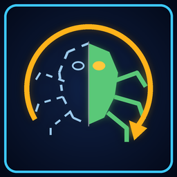

# Restored Content



**The game's cut enemies, working again, for level packs to use.**

Version **0.1.1** · Content · by VibinToast · made in JFG-Studio

## About

The game's cut enemies, made to work again so level packs can place them. On its own it adds nothing to the game: it is what packs like the Restored Content Gallery build on, and it is installed with them.

## Install

- **In the game's launcher:** open **Get Mods**, pick it and press **Install**: what it needs comes with it.
- **By hand:** download `jfg_restored_content.nrm` from its release, [`jfg_restored_content-v0.1.1`](https://github.com/VibinToast/JFG-Restored-Content/releases/tag/jfg_restored_content-v0.1.1), and put it in the game's `mods` folder.

## Build

`restored_content.jfgproj/` is the JFG-Studio project: the object types it makes from the game's own (the cut enemies and props, fixed up to work) and its enemy behaviour fixes (`baddies.json`). Open it in JFG-Studio to see or change it, then build it there, or from the command line:

```sh
jfgstudio build restored_content.jfgproj -o jfg_restored_content.nrm
```

JFG-Studio reads the game's own data from your ROM, so the project holds only what the pack changes or adds.
