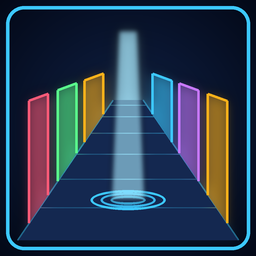

# Restored Content Gallery



**A hub of rooms showing every cut enemy, prop, pickup and light. Warp in front of King Jeff's house.**

Version **0.2.0** · Levels, Content · by VibinToast · made in JFG-Studio · needs [jfg_restored_content](../jfg_restored_content) (installed with it)

## About

A hub of rooms, one for each piece of the game's cut content brought back: its enemies, props, pickups, lights and the heroes' unused bodies. Walk up to a door and its sign tells you what is behind it. To get there, take the warp in front of King Jeff's house; the hub's exit brings you back. Uses Restored Content, which is installed with it.

## Install

- **In the game's launcher:** open **Get Mods**, pick it and press **Install**: what it needs comes with it.
- **By hand:** download `jfg_restored_content_test_hub.nrm` from its release, [`jfg_restored_content_test_hub-v0.2.0`](https://github.com/VibinToast/JFG-Restored-Content/releases/tag/jfg_restored_content_test_hub-v0.2.0), and put it in the game's `mods` folder with what it needs.

## Build

`gallery.jfgproj/` is the JFG-Studio project: the hub and its rooms (`levels/`), the door signs (`scripts/labels.lua`) and the warp added to a stock level. Open it in JFG-Studio to see or change it, then build it there, or from the command line:

```sh
jfgstudio build gallery.jfgproj -o jfg_restored_content_test_hub.nrm
```

JFG-Studio reads the game's own data from your ROM, so the project holds only what the pack changes or adds.

The hub's and rooms' geometry (`geometry/hub.glb`, `geometry/room.glb`) isn't in this repo: it is painted with the game's own textures, which can't be published. The released `.nrm` is complete, and names those textures by number so each player's game shows them from their own ROM. To rebuild the pack, make the two rooms again in Blender with the game's level textures (JFG-Studio's texture library) and import them under those names.
